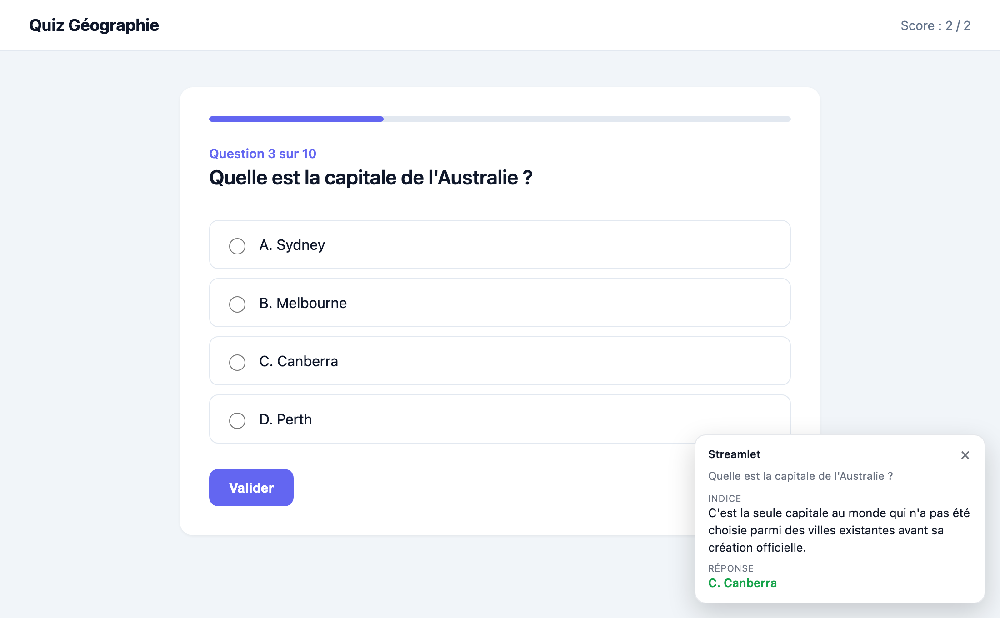
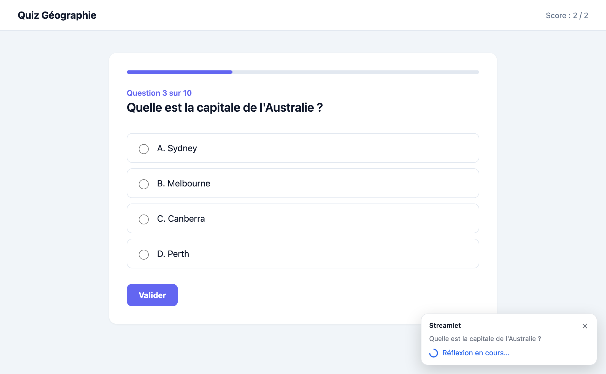
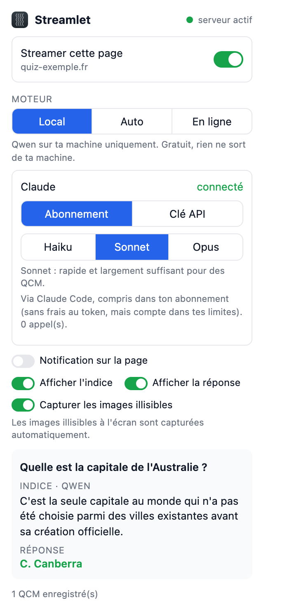
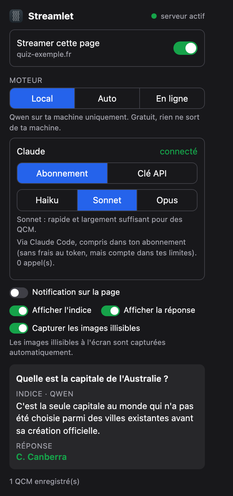

<p align="center">
  
</p>

<h1 align="center">Streamlet</h1>

<p align="center"><b>English</b> · <a href="README.md">Français</a></p>

<p align="center">
  Browser extension that reads the multiple-choice question shown in a tab and asks an AI
  (local with Ollama, or online with Claude) for a <b>hint</b> to find the answer, and the answer itself if you want it.
</p>

<p align="center">
  
</p>

> **Read this before using Streamlet.** This application is designed first and foremost for **benchmarking AI
> models in real conditions**. See the [disclaimer](#disclaimer): the author disclaims any use that would amount
> to cheating.

---

## Contents

- [How it works](#how-it-works)
- [Requirements](#requirements)
- [Installation](#installation)
- [Load the extension in your browser](#load-the-extension-in-your-browser)
- [Manage the server](#manage-the-server)
- [Usage](#usage)
- [AI engines](#ai-engines)
- [Generated files](#generated-files)
- [Server options](#server-options)
- [Uninstall](#uninstall)
- [Troubleshooting](#troubleshooting)
- [Privacy](#privacy)
- [Publishing a release](#publishing-a-release)
- [Disclaimer](#disclaimer)

## How it works

```
 Browser                            Your computer                       AI
┌─────────────────────┐   HTTP    ┌──────────────────────┐     ┌──────────────────────┐
│ Streamlet extension │ ────────▶ │ serveur_qcm.py       │ ──▶ │ Ollama (Qwen, local) │
│ reads the HTML of   │ 127.0.0.1 │ port 8765            │     ├──────────────────────┤
│ the tab you turn on │ ◀──────── │ hint + answer        │ ──▶ │ Claude (online)      │
└─────────────────────┘           └──────────────────────┘     └──────────────────────┘
```

1. You turn Streamlet on for a tab. The extension can only access the sites you turn it on for.
2. Whenever the page changes, it finds the question and its choices (radio buttons, checkboxes, ARIA roles,
   or the page text as a fallback) and sends them to the local server.
3. The server asks the AI for a hint (and the answer), then the extension shows it at the bottom right of the
   page or in the popup.

## Requirements

| | Version |
|---|---|
| Browser | Chrome, Edge, Brave, Arc, Opera… (Chromium browsers) or **Firefox 140+** |
| System | macOS, Linux or Windows 10/11 |
| Python | 3.10 or later: installed by the setup script if missing (Homebrew on macOS, package manager on Linux, `winget` on Windows) |
| Ollama | installed by the script, only if you choose the local AI |
| Disk space | a few GB for the local model `qwen3.5:4b` (local AI only) |
| Claude (optional) | a claude.ai subscription + [Claude Code](https://claude.com/claude-code), **or** an Anthropic API key |

> Safari is not supported.

## Installation

Clone the repository:

```bash
git clone <repository-url> Streamlet
cd Streamlet
```

Run the setup script for your system:

| System | Command |
|---|---|
| macOS | `./install-macos.sh` |
| Linux | `./install-linux.sh` |
| Windows (PowerShell) | `powershell -ExecutionPolicy Bypass -File install.ps1` |

> **Linux**: anything missing from the system (Python, `python3-venv`, `curl`, Ollama) is installed with `sudo`,
> so you will be asked for your password. The script uses your distribution's package manager
> (apt, dnf, pacman or zypper).

The scripts follow your system language (English or French); force it with `--lang en` (`-Lang en` on Windows).

### The questionnaire

The script asks a few questions so it only installs what you need, then takes care of everything.
Press **Enter** to keep the default choice (in bold).

| # | Question | Possible choices |
|---|---|---|
| 1 | **Which AI do you want to use?** | **Claude only** (default, nothing heavy to install) · Local AI + Claude as fallback · Local AI only (Ollama, a few GB) |
| 2 | **Which local model?** *(if local AI)* | **`qwen3.5:4b`** (default, ~4 GB) · `qwen3.5:2b` (lighter) · any other Ollama model |
| 3 | **How do you want to access Claude?** *(if Claude)* | **your claude.ai subscription** via Claude Code (no extra cost) · an API key (pay as you go) |
| 4 | **How should the server run?** | **Persistent** · Ephemeral (see below) |

With the subscription, if Claude Code is not installed or not signed in, the script offers to install it and
open the sign-in page. A summary is shown next, and installation only starts once you confirm.

The extension's engine is set from your answers: **Online** (Claude only), **Auto** (local AI + Claude)
or **Local**. You can change it anytime in the popup, where you also pick the Claude model
(Haiku, Sonnet or Opus, see [Connect Claude](#connect-claude)).

### Persistent or ephemeral?

Streamlet needs a small **local server** (`serveur_qcm.py`, port `8765`) that links the extension to the AI.
It can run in two ways:

| | **Persistent** (default) | **Ephemeral** |
|---|---|---|
| Where the server runs | in the background, no window | in the terminal where you ran the script |
| Closing the terminal | does not stop it | **stops it** (like Ctrl+C) |
| Restarting the computer | it starts again on its own when you log in | start it again by hand |
| If it crashes | restarted automatically after 5 s | stays stopped |
| Best for | everyday use | trying Streamlet, or occasional use |

### What the script does

1. checks Python 3.10+ and installs it if missing (Homebrew on macOS, `sudo apt`/`dnf`/`pacman`/`zypper` on Linux,
   `winget` on Windows). On Debian/Ubuntu it also adds `python3-venv`, which provides `venv` and `pip`;
2. *if local AI*: installs Ollama if missing ([ollama.com](https://ollama.com)), starts it and downloads the model;
3. *if Claude subscription*: installs Claude Code and signs it in to your account, if you agreed;
4. creates the Python environment `.venv` and installs the dependencies from `requirements.txt`;
5. saves your settings (engine and Claude access);
6. **persistent**: installs the server as a background service and starts it; you can close the terminal.
   **ephemeral**: starts the server in the terminal; it runs as long as the terminal stays open.
   The command to start it again later is shown before it starts, and again when you stop it with Ctrl+C,
   for example:

   ```bash
   cd "/path/to/Streamlet" && .venv/bin/python serveur_qcm.py              # macOS / Linux
   cd "C:\path\to\Streamlet"; .venv\Scripts\python.exe serveur_qcm.py     # Windows
   ```

You can safely run the script again (to switch mode or model, or after a `git pull`):
anything already installed is not reinstalled.

### Without questions

If you pass an option, the script asks no questions. Handy to automate an installation:

| macOS / Linux | Windows | Effect |
|---|---|---|
| `--yes` | `-Yes` | default settings (Claude via subscription, no local AI, persistent) |
| `--lang en` | `-Lang en` | message language (`en` or `fr`, auto-detected otherwise) |
| `--ephemeral` | `-Ephemeral` | ephemeral server instead of persistent |
| `--with-ollama` | `-WithOllama` | add the local AI (Ollama + `qwen3.5:4b`) |
| `--model qwen3.5:2b` | `-Model qwen3.5:2b` | another Ollama model (turns on the local AI) |
| `--claude api` | `-Claude api` | Claude access: `subscription` (default), `api` or `none` |

Example: `./install-linux.sh --claude api --ephemeral`.
With no option but no keyboard either (run by another program, in CI…), the script also uses the default settings.
The French option names (`--oui`, `--ephemere`, `--avec-ollama`, `--modele`…) work too.

<details>
<summary>Manual installation (without the script)</summary>

```bash
# 1. Ollama (local AI only): https://ollama.com/download, then:
ollama pull qwen3.5:4b

# 2. Python environment
python3 -m venv .venv
.venv/bin/pip install -r requirements.txt          # Windows: .venv\Scripts\pip install -r requirements.txt

# 3. Server: see "Manage the server" below
```
</details>

## Load the extension in your browser

The same `extension/` folder is used for every browser.

### Chrome, Edge, Brave, Arc, Opera…

1. Open `chrome://extensions` (or `edge://extensions`, `brave://extensions`…).
2. Turn on **Developer mode** (top right).
3. Click **Load unpacked** and pick the repository's `extension/` folder.
4. Pin Streamlet to the toolbar (puzzle icon › pin).

After updating the repository (`git pull`), click ↻ on the Streamlet card in `chrome://extensions`.

### Firefox

**Recommended**: install the signed `.xpi` attached to the repository's [Releases](../../releases)
(`about:addons` › gear icon › **Install Add-on From File…**). It stays installed after a restart and
**Firefox then updates it on its own** (from version 1.1): it checks for a new release about once a day.
On Ubuntu, Firefox (snap) only sees your home folder: copy the `.xpi` to `~/Downloads` first if needed.

To try the code from the repository directly:

1. Open `about:debugging#/runtime/this-firefox`.
2. Click **Load Temporary Add-on…** and pick `extension/manifest.json`.
3. Pin Streamlet to the toolbar (puzzle icon › gear › Pin to Toolbar).

> **Firefox removes add-ons loaded this way on every restart**: repeat step 2.
> Without a signed `.xpi`, only **Firefox Developer Edition** and **Nightly** keep the extension: in `about:config`,
> set `xpinstall.signatures.required` to `false`, build the package (`cd extension && zip -r ../streamlet.xpi .`)
> and install it the same way.

With the signed `.xpi`, updates are automatic (`about:addons` › gear icon › **Check for Updates** to force a
check). For the temporary version, click **Reload** on the Streamlet card in `about:debugging` after a `git pull`.

## Manage the server

The dot at the top of the popup is **green** when the server is running, **red** otherwise.
You can also open <http://127.0.0.1:8765/etat>.

In the commands below, replace `.venv/bin/python` with `.venv\Scripts\python.exe` on Windows.

### Persistent mode

| Action | Command |
|---|---|
| Install and start | `.venv/bin/python serveur_qcm.py --installer` (what the setup script does) |
| Stop and remove | `.venv/bin/python serveur_qcm.py --desinstaller` |
| Change settings | run `--installer` again with the new options, e.g. `--installer --modele qwen3.5:2b` |
| Read the log | `~/.streamlet/serveur.log` (Windows: `%USERPROFILE%\.streamlet\serveur.log`) |

How it is done on each system:

| System | Mechanism | File created |
|---|---|---|
| macOS | **launchd** agent | `~/Library/LaunchAgents/app.streamlet.serveur.plist` |
| Linux | **systemd user** service | `~/.config/systemd/user/streamlet.service` |
| Windows | hidden launcher in the **Startup** folder (no window, no admin rights) | `%APPDATA%\Microsoft\Windows\Start Menu\Programs\Startup\Streamlet.vbs` |

> **Linux**: a user service stops when you log out (not when you close the terminal).
> To keep it running without an open session: `sudo loginctl enable-linger $USER`.

### Ephemeral mode

```bash
cd /path/to/Streamlet
.venv/bin/python serveur_qcm.py              # macOS / Linux; keep the terminal open
.venv\Scripts\python.exe serveur_qcm.py     # Windows
```

This is the command the setup script shows in ephemeral mode.

Ctrl+C or closing the terminal stops it. Start it again whenever you want to use Streamlet.

> Both modes use the same port: if persistent mode is installed, ephemeral mode shows
> "port 8765 already in use". Remove persistent mode first (`--desinstaller`) to switch to ephemeral.

## Usage

1. Go to the quiz page and click the Streamlet icon.
2. Turn on **Stream this page**. The browser asks for access to the site, once per site.
   The `ON` badge appears on the icon.
3. Pick the **engine** (see below).
4. As soon as a question is detected, a small window appears at the bottom right of the page: first
   "Thinking…", then the hint (and the answer if you turned it on).

<p align="center">
  
  
</p>

### Reminder and auto-stop

While Streamlet is on for a tab, the popup reminds you to turn it off after the quiz: every new page in the tab
is sent to the AI, which uses tokens with Claude (subscription quota or API credits).
For safety, **Streamlet turns itself off after 2 minutes without a quiz question** on the page, and says so in a
small window at the bottom right.

### Language

The extension is shown in English or French depending on the browser language, and the server answers in the
same language (error messages, warnings). The setup scripts follow the system language
(`--lang en|fr` / `-Lang en|fr` to force it). Hints are written in the language of the question.

### Knowledge themes

The local AI (Qwen) is weak on some "memorized" facts, like French department numbers or currencies.
**Knowledge themes** are themed fact files stored on your computer: for each question, Streamlet looks up the
facts related to it (keyword search on the question and choices) and gives them to Qwen with the question.
Nothing leaves your computer, and Claude does not use them.

Measured on the French departments quiz (Local engine, Fast reasoning): **8/10 without a theme, 10/10 with the
"Départements de France" theme**, in the same time (~5 s).

- **Manage themes**: in the popup, "Local AI" card › **Manage…**. The page opens in a tab: drop a file
  (drag and drop or "Choose a file"), check the preview (theme name, number of facts, first facts), then confirm.
  Each theme can be turned on or off, and the ones you added can be deleted.
- **Accepted formats** (5 MB max, UTF-8 text):

  | File | How it is read |
  |---|---|
  | `.csv` | each row is a fact, with the column names ("number: 47 · department: Lot-et-Garonne"). Separator: comma, semicolon or tab. Easiest: export from Excel, Numbers or Google Sheets |
  | `.txt` / `.md` | each line is a fact (or each paragraph, for written text); a first `# Title` line names the theme |
  | `.json` / `.jsonl` | a list of objects or sentences, one fact per item (JSONL: one per line) |

  The theme is named after the file, or its `# Title`. The page offers CSV and TXT templates to download.
- **Where the files are**: bundled themes are in `connaissances/` (in the repository); the ones you add are in
  `~/.streamlet/connaissances/`. You can also drop a file there by hand: it is picked up the next time the server starts.
- **Bundled theme**: *Départements de France* (101 departments: number, name, prefecture, region), built from the
  [INSEE 2024 Official Geographic Code](https://www.insee.fr/fr/information/7766585) (Licence Ouverte Etalab 2.0).

### The popup

<p align="center">
  
  &nbsp;&nbsp;
  
</p>

From top to bottom: server status (green dot), tab switch, engine, then depending on the engine:
- **Local**: local AI reasoning and a card about the local model (name, memory used compared with the
  computer's total, share on the GPU, size on disk, time before the memory is freed); the Claude part is
  hidden, since Claude is never called;
- **Auto**: both;
- **Online**: the Claude connection and Claude model.

Then come the display settings. When "Notification on the page" is off, the result is shown in the popup (as above) instead of the
page. The popup follows the system's light or dark theme. *(Screenshots in French; the popup is shown in your
browser language.)*

Popup settings:

| Setting | Effect |
|---|---|
| Local AI reasoning *(Local and Auto engines)* | **Fast** (~5 s, Qwen thinks for 3 s then gives the answer only, **no hint**: with so little reasoning, hints are unreliable; less reliable on tricky or multi-step questions) or **Normal** (~25 s, Qwen reasons for up to 20 s, then gives a hint and the answer). Applied right away, no server restart |
| Notification on the page | shows results on the page; otherwise they stay in the popup |
| Show the hint | shows the hint |
| Show the answer | also shows the right answer (off by default) |
| Capture unreadable images | when a question includes an image from another site, the extension takes a screenshot of it. Asks for access to all sites. Otherwise: **right-click the image › "Streamlet: read this image"** |

Icon badges: `ON` = on · `✗` = server unreachable · `!` = page cannot be read (internal browser page, Chrome Web Store…).

## AI engines

| Engine | What happens | Cost | Privacy |
|---|---|---|---|
| **Local** | Qwen via Ollama, on your computer (about 25 s per question, or 5 s with “Fast” reasoning, which gives the answer without a hint) | free | nothing leaves your computer |
| **Auto** | Qwen first; Claude takes over if Qwen is too slow (90 s), fails or is stopped | free most of the time | Claude only as a fallback |
| **Online** | Claude directly: faster, understands images and complex pages | see below | the question is sent to Anthropic |

### Connect Claude

In the popup, **Claude** section, pick the access:

- **Subscription** (Claude Pro / Max): goes through [Claude Code](https://claude.com/claude-code), no API key.
  1. Install Claude Code (see the link), or let the setup script do it.
  2. In a terminal: `claude auth login`, with your claude.ai account.
  3. The popup shows "connected". Calls count toward your subscription limits.
- **API key**: create a key at [console.anthropic.com](https://console.anthropic.com/settings/keys) and paste it in the popup.
  It is stored in the system keychain (macOS Keychain, Windows Credential Manager, Secret Service on Linux),
  never in the extension. Billed per token; the estimated cost is shown in the popup.
  The `ANTHROPIC_API_KEY` environment variable is also supported.

Then pick the model: **Haiku** (fastest), **Sonnet** (recommended) or **Opus** (most capable).

## Generated files

In the project folder (ignored by git):

| File | Content |
|---|---|
| `qcm.json` | detected questions, choices and their position, hint, answer (no duplicates) |
| `raisonnements.jsonl` | the model's reasoning / explanation, one JSON line per question |

**Retention: 24 h.** Older questions and reasoning are deleted automatically, when the server starts and on
each new question, so the files stay small.

Why not delete them as soon as they are shown? `qcm.json` is also a **cache**. The extension sends the page again
on every change (clicking a choice, refreshing, going back), and a question already there is shown again right
away, without calling the AI again, so no waiting and no quota used.

To change the duration: `serveur_qcm.py --conservation 2` (hours), or `--conservation 0` to keep everything.

Popup settings: `~/.streamlet/config.json`.

> **Versions 1.0 and earlier**: settings were in `~/.shabcode/` and the API key was stored as `shabcode-qcm`
> in the keychain. The server picks them up automatically on first start (the old ones are not deleted).

## Server options

```bash
.venv/bin/python serveur_qcm.py --help
```

| Option | Default | Purpose |
|---|---|---|
| `--modele` | `qwen3.5:4b` | Ollama model that writes the hint (with reasoning) |
| `--modele-rapide` | `qwen3.5:4b` | Ollama model that finds the question on pages without radio buttons |
| `--reflexion-max` | `20` | length of “Normal” reasoning in seconds (Fast / Normal is picked in the popup; `0` = Fast by default) |
| `--delai-local` | `90` | Auto engine: seconds given to Qwen before switching to Claude |
| `--port` | `8765` | server port. If you change it, also change `SERVEUR` in `extension/background.js` and `extension/popup.js` |
| `--out` | `qcm.json` | questions file |
| `--raisonnements` | `raisonnements.jsonl` | reasoning file |
| `--conservation` | `24` | hours questions are kept (`0` = forever) |
| `--installer` / `--desinstaller` | | install / remove the server in persistent mode |
| `--journal` | | write the server output to a file instead of the terminal |

Options passed with `--installer` are kept by the background service, e.g.
`serveur_qcm.py --installer --modele qwen3.5:2b`. The server's own log is in French.

## Uninstall

```bash
.venv/bin/python serveur_qcm.py --desinstaller    # Windows: .venv\Scripts\python.exe serveur_qcm.py --desinstaller
ollama rm qwen3.5:4b                              # frees the model's disk space (local AI only)
```

Then remove the extension (`chrome://extensions`, or `about:addons` on Firefox), delete the project folder and the
settings folder `~/.streamlet/`. Ollama uninstalls like any other application.

## Troubleshooting

| Symptom | Fix |
|---|---|
| "server stopped" in the popup, `✗` badge | start the server (see [Manage the server](#manage-the-server)) or check the log `~/.streamlet/serveur.log` |
| `le port 8765 est déjà utilisé` (port already in use) | a server is already running (often the background service): nothing to do, or `--desinstaller` |
| Local engine too slow or no answer | check that Ollama is running (`ollama list`); switch reasoning to “Fast” in the popup, use a lighter model (`--modele qwen3.5:2b`) or the Auto engine |
| `model not found` | `ollama pull qwen3.5:4b` (or the model passed with `--modele`) |
| Claude "not connected" (subscription) | `claude auth login` in a terminal; check with `claude auth status` |
| Ubuntu / Debian: `No module named pip` | run `./install-linux.sh` again: it installs `python3-venv` and recreates `.venv`. By hand: `sudo apt install python3-venv`, then `rm -rf .venv` and run the script again |
| Linux: `keyring` error with an API key | install a Secret Service keychain (`sudo apt install gnome-keyring`, or KWallet), or use `ANTHROPIC_API_KEY` |
| Linux: the persistent server stops when you log out | `sudo loginctl enable-linger $USER` |
| The server stops when I close the terminal | that is ephemeral mode: run the setup script again and choose "Persistent" |
| Windows: "running scripts is disabled" | run the script with `powershell -ExecutionPolicy Bypass -File install.ps1` |
| No question detected | reload the page; some very dynamic pages need the "Online" engine |

## Privacy

- The extension only has access to the sites you turn it on for, one by one, and only talks to the local server `127.0.0.1:8765`.
- The server only accepts local requests.
- With the **Local** engine, nothing leaves your computer. With **Auto** (fallback) and **Online**, the question
  content (text and any images) is sent to Anthropic.
- The files `qcm.json` and `raisonnements.jsonl` stay on your computer and are not versioned.

## Publishing a release

*For repository maintainers.* Firefox only keeps add-ons signed by Mozilla, so each version is signed and the
`.xpi` file is attached to a GitHub Release.

### Once: the signing keys

1. Create a developer account at [addons.mozilla.org](https://addons.mozilla.org/developers/) and accept the agreement.
2. Generate your keys on the [API keys page](https://addons.mozilla.org/developers/addon/api/key/).
3. Put them in a `.env` file at the project root (ignored by git, **never commit it**):

   ```
   WEB_EXT_API_KEY=user:12345:678
   WEB_EXT_API_SECRET=your-secret
   ```

If they leak, revoke them on the same page and generate new ones.

### For each version

1. Bump `"version"` in `extension/manifest.json` (e.g. `1.1` → `1.2`): Mozilla rejects two uploads with the
   same number.
2. Commit and push the code.
3. Run the publishing script. It signs the extension with Mozilla (without listing it in Mozilla's catalog,
   automatic review in a few minutes), saves the file as `web-ext-artifacts/streamlet-<version>.xpi`
   and adds the version to `updates.json`:

   ```bash
   ./scripts/publier-firefox.sh
   ```

4. Commit and push `updates.json`.
5. Create the GitHub Release `v<version>` and attach the `.xpi` **without renaming it** (e.g. with `gh`:
   `gh release create v1.2 web-ext-artifacts/streamlet-1.2.xpi --title "Streamlet 1.2" --notes "…"`).

`updates.json` (at the repository root) is the file Firefox checks for automatic updates
(`update_url` in `extension/manifest.json`). Order matters: publish the Release before or together with the push
of `updates.json`, otherwise Firefox would find an announced version that cannot be downloaded yet (it simply
tries again later).

> The ID `streamlet@streamlet.app` (`extension/manifest.json`) is tied to the account that signs the first
> version: it must never change afterwards.

## Disclaimer

Streamlet is designed first and foremost as a **dynamic AI model benchmarking tool**: comparing local and online
models on real question pages, in real conditions (answer accuracy, response time, effect of reasoning and of
knowledge themes, memory used).

The author disclaims all responsibility for any use that could amount to cheating (exams, competitive exams, graded
assessments, recruitment tests…) or that would breach the rules of a website, an institution or a platform. Each
user remains solely responsible for how they use Streamlet.
