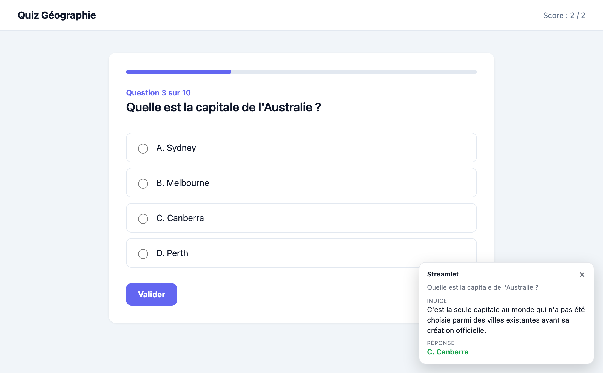
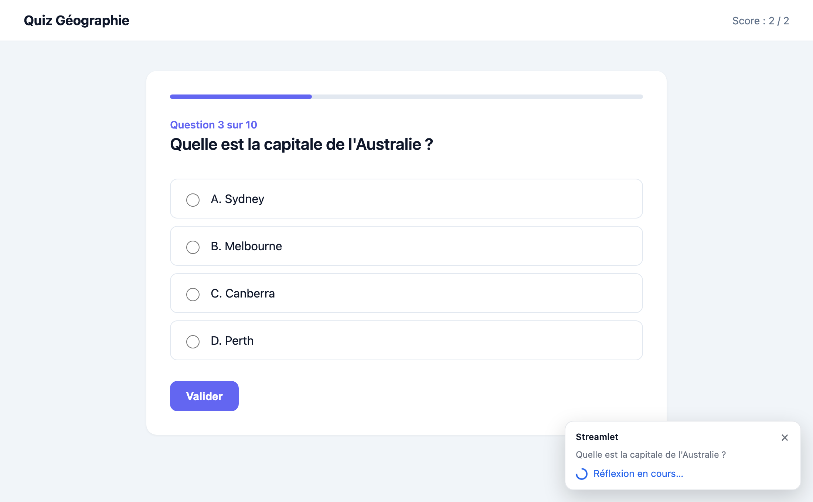
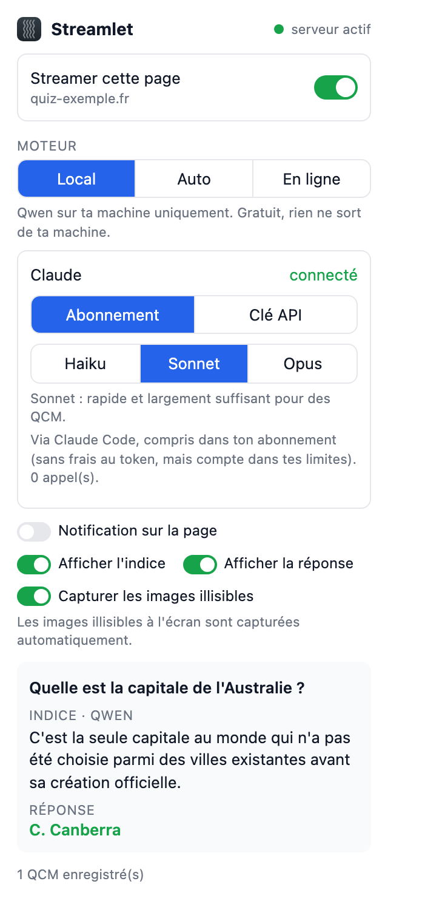
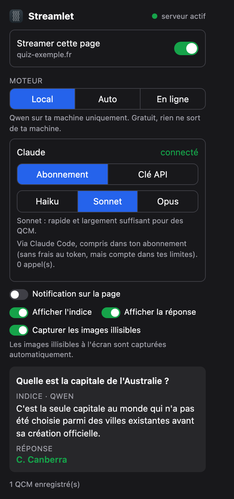

<p align="center">
  
</p>

<h1 align="center">Streamlet</h1>

<p align="center">
  Extension de navigateur qui lit la question de QCM affichée dans un onglet et demande à une IA
  (locale avec Ollama, ou en ligne avec Claude) un <b>indice</b> pour la trouver, et la réponse si tu le souhaites.
</p>

<p align="center">
  
</p>

---

## Sommaire

- [Fonctionnement](#fonctionnement)
- [Prérequis](#prérequis)
- [Installation](#installation)
- [Charger l'extension dans le navigateur](#charger-lextension-dans-le-navigateur)
- [Gérer le serveur](#gérer-le-serveur)
- [Utilisation](#utilisation)
- [Moteurs d'IA](#moteurs-dia)
- [Fichiers générés](#fichiers-générés)
- [Options du serveur](#options-du-serveur)
- [Désinstallation](#désinstallation)
- [Dépannage](#dépannage)
- [Confidentialité](#confidentialité)

## Fonctionnement

```
 Navigateur                         Ta machine                          IA
┌─────────────────────┐   HTTP    ┌──────────────────────┐     ┌──────────────────────┐
│ Extension Streamlet │ ────────▶ │ serveur_qcm.py       │ ──▶ │ Ollama (Qwen, local) │
│ lit le HTML de      │ 127.0.0.1 │ port 8765            │     ├──────────────────────┤
│ l'onglet activé     │ ◀──────── │ indice + réponse     │ ──▶ │ Claude (en ligne)    │
└─────────────────────┘           └──────────────────────┘     └──────────────────────┘
```

1. Tu actives Streamlet sur un onglet. L'extension n'a accès qu'aux sites que tu actives.
2. À chaque changement de la page, elle repère la question et ses choix (boutons radio, cases à cocher,
   rôles ARIA, ou à défaut le texte de la page) et les envoie au serveur local.
3. Le serveur demande à l'IA un indice (et la réponse), puis l'extension l'affiche en bas à droite de la page
   ou dans la popup.

## Prérequis

| | Version |
|---|---|
| Navigateur | Chrome, Edge, Brave, Arc, Opera… (navigateurs Chromium) ou **Firefox 128+** |
| Système | macOS, Linux ou Windows 10/11 |
| Python | 3.10 ou plus : installé par le script d'installation s'il manque (Homebrew sur macOS, gestionnaire de paquets sous Linux, `winget` sous Windows) |
| Ollama | installé par le script (facultatif si tu n'utilises que Claude) |
| Espace disque | quelques Go pour le modèle local `qwen3.5:4b` |
| Claude (facultatif) | un abonnement claude.ai + [Claude Code](https://claude.com/claude-code), **ou** une clé API Anthropic |

> Safari n'est pas pris en charge.

## Installation

Clone le dépôt :

```bash
git clone <url-du-depot> Streamlet
cd Streamlet
```

Lance le script d'installation de ton système :

| Système | Commande |
|---|---|
| macOS | `./install-macos.sh` |
| Linux | `./install-linux.sh` |
| Windows (PowerShell) | `powershell -ExecutionPolicy Bypass -File install.ps1` |

> **Linux** : ce qui manque au système (Python, `python3-venv`, `curl`, Ollama) est installé avec `sudo`,
> donc ton mot de passe te sera demandé. Le script utilise le gestionnaire de paquets de ta distribution
> (apt, dnf, pacman ou zypper).

### Le questionnaire

Le script te pose quelques questions pour n'installer que ce dont tu as besoin, puis s'occupe de tout.
Appuie sur **Entrée** pour garder le choix recommandé.

| # | Question | Choix possibles |
|---|---|---|
| 1 | **Quelle IA veux-tu utiliser ?** | **IA locale + Claude en secours** (recommandé) · IA locale uniquement · Claude uniquement (pas d'Ollama, rien de lourd à télécharger) |
| 2 | **Quel modèle local ?** *(si IA locale)* | **`qwen3.5:4b`** (~4 Go) · `qwen3.5:2b` (plus léger) · un autre modèle Ollama de ton choix |
| 3 | **Comment accéder à Claude ?** *(si Claude)* | **ton abonnement claude.ai** via Claude Code (pas de frais en plus) · une clé API (payée à l'usage) |
| 4 | **Comment faire tourner le serveur ?** | **Durable** · Éphémère (voir ci-dessous) |

Avec l'abonnement, si Claude Code n'est pas installé ou pas connecté, le script propose de l'installer et
d'ouvrir la page de connexion. Un récapitulatif s'affiche ensuite, et l'installation ne démarre qu'après ta confirmation.

Le moteur de l'extension est réglé d'après tes réponses : **Auto** (IA locale + Claude), **Local** ou
**En ligne**. Tu peux le changer à tout moment dans la popup, où se choisit aussi le modèle Claude
(Haiku, Sonnet ou Opus, voir [Connecter Claude](#connecter-claude)).

### Durable ou éphémère ?

Streamlet a besoin d'un petit **serveur local** (`serveur_qcm.py`, port `8765`) qui fait le lien entre
l'extension et l'IA. Il peut tourner de deux façons :

| | **Durable** (recommandé) | **Éphémère** |
|---|---|---|
| Où tourne le serveur | en tâche de fond, sans fenêtre | dans le terminal où tu as lancé le script |
| Fermer le terminal | ne l'arrête pas | **l'arrête** (comme Ctrl+C) |
| Redémarrage de l'ordinateur | il redémarre tout seul à l'ouverture de session | à relancer à la main |
| S'il plante | relancé automatiquement après 5 s | reste arrêté |
| Idéal pour | l'usage quotidien | essayer Streamlet, ou ne l'utiliser que de temps en temps |

### Ce que fait le script

1. vérifie Python 3.10+ et l'installe s'il manque (Homebrew sur macOS, `sudo apt`/`dnf`/`pacman`/`zypper` sous Linux,
   `winget` sous Windows). Sous Debian/Ubuntu, il ajoute aussi `python3-venv`, qui contient `venv` et `pip` ;
2. *si IA locale* : installe Ollama s'il est absent ([ollama.com](https://ollama.com)), le démarre et télécharge le modèle ;
3. *si abonnement Claude* : installe Claude Code et le connecte à ton compte, si tu l'as accepté ;
4. crée l'environnement Python `.venv` et installe les dépendances de `requirements.txt` ;
5. enregistre tes réglages (moteur et accès à Claude) ;
6. **durable** : installe le serveur en tâche de fond et le démarre ; tu peux fermer le terminal.
   **éphémère** : démarre le serveur dans le terminal ; il tourne tant que le terminal reste ouvert.
   La commande pour le relancer plus tard s'affiche avant le démarrage, puis de nouveau quand tu l'arrêtes
   avec Ctrl+C, par exemple :

   ```bash
   cd "/chemin/vers/Streamlet" && .venv/bin/python serveur_qcm.py              # macOS / Linux
   cd "C:\chemin\vers\Streamlet"; .venv\Scripts\python.exe serveur_qcm.py     # Windows
   ```

Le script peut être relancé sans risque (pour changer de mode, de modèle, ou après un `git pull`) :
ce qui est déjà installé n'est pas réinstallé.

### Sans questions

Si tu passes une option, le script ne pose aucune question. C'est pratique pour automatiser une installation :

| macOS / Linux | Windows | Effet |
|---|---|---|
| `--oui` | `-Oui` | réglages recommandés (IA locale + Claude par abonnement, durable) |
| `--ephemere` | `-Ephemere` | serveur éphémère au lieu de durable |
| `--modele qwen3.5:2b` | `-Modele qwen3.5:2b` | autre modèle Ollama |
| `--sans-ollama` | `-SansOllama` | sans IA locale : Claude uniquement |
| `--claude api` | `-Claude api` | accès à Claude : `abonnement` (défaut), `api` ou `aucun` |

Exemple : `./install-linux.sh --sans-ollama --claude api --ephemere`.
Sans option, mais lancé sans clavier (par un autre programme, en CI…), le script prend aussi les réglages recommandés.

<details>
<summary>Installation manuelle (sans script)</summary>

```bash
# 1. Ollama : https://ollama.com/download, puis :
ollama pull qwen3.5:4b

# 2. Environnement Python
python3 -m venv .venv
.venv/bin/pip install -r requirements.txt          # Windows : .venv\Scripts\pip install -r requirements.txt

# 3. Serveur : voir « Gérer le serveur » ci-dessous
```
</details>

## Charger l'extension dans le navigateur

Le même dossier `extension/` sert pour tous les navigateurs.

### Chrome, Edge, Brave, Arc, Opera…

1. Ouvre `chrome://extensions` (ou `edge://extensions`, `brave://extensions`…).
2. Active le **Mode développeur** (en haut à droite).
3. Clique sur **Charger l'extension non empaquetée** et choisis le dossier `extension/` du dépôt.
4. Épingle Streamlet dans la barre d'outils (icône puzzle › épingle).

Après une mise à jour du dépôt (`git pull`), clique sur ↻ dans la carte Streamlet de `chrome://extensions`.

### Firefox

1. Ouvre `about:debugging#/runtime/this-firefox`.
2. Clique sur **Charger un module complémentaire temporaire…** et choisis le fichier `extension/manifest.json`.
3. Épingle Streamlet dans la barre d'outils (icône puzzle › roue dentée › Épingler à la barre d'outils).

> **Firefox retire les extensions chargées ainsi à chaque redémarrage** : il faut refaire l'étape 2.
> Il n'installe durablement que les extensions signées par Mozilla. Pour garder Streamlet :
> - **Firefox Developer Edition ou Nightly** : dans `about:config`, passe `xpinstall.signatures.required` à `false`,
>   puis installe un paquet `.xpi` de l'extension (un zip du contenu de `extension/`, renommé en `.xpi`) depuis
>   `about:addons` › roue dentée › **Installer un module depuis un fichier…** ;
> - **Firefox classique** : il faut un `.xpi` signé par Mozilla (via [addons.mozilla.org](https://addons.mozilla.org/developers/),
>   gratuit, publication facultative).

Après une mise à jour du dépôt, clique sur **Recharger** dans la carte Streamlet de `about:debugging`.

## Gérer le serveur

Le point en haut de la popup est **vert** quand le serveur tourne, **rouge** sinon.
Tu peux aussi ouvrir <http://127.0.0.1:8765/etat>.

Dans les commandes ci-dessous, remplace `.venv/bin/python` par `.venv\Scripts\python.exe` sous Windows.

### Mode durable

| Action | Commande |
|---|---|
| Installer et démarrer | `.venv/bin/python serveur_qcm.py --installer` (ce que fait le script d'installation) |
| Arrêter et retirer | `.venv/bin/python serveur_qcm.py --desinstaller` |
| Changer les réglages | relancer `--installer` avec les nouvelles options, par ex. `--installer --modele qwen3.5:2b` |
| Lire le journal | `~/.shabcode/serveur_qcm.log` (Windows : `%USERPROFILE%\.shabcode\serveur_qcm.log`) |

Comment c'est fait, selon le système :

| Système | Mécanisme | Fichier créé |
|---|---|---|
| macOS | agent **launchd** | `~/Library/LaunchAgents/com.shabcode.qcm.plist` |
| Linux | service **systemd utilisateur** | `~/.config/systemd/user/streamlet.service` |
| Windows | lanceur caché dans le dossier **Démarrage** (aucune fenêtre, aucun droit admin) | `%APPDATA%\Microsoft\Windows\Start Menu\Programs\Startup\Streamlet.vbs` |

> **Linux** : un service utilisateur s'arrête quand tu fermes ta session (pas quand tu fermes le terminal).
> Pour qu'il tourne même sans session ouverte : `sudo loginctl enable-linger $USER`.

### Mode éphémère

```bash
cd /chemin/vers/Streamlet
.venv/bin/python serveur_qcm.py              # macOS / Linux ; garde le terminal ouvert
.venv\Scripts\python.exe serveur_qcm.py     # Windows
```

C'est la commande que le script d'installation affiche en mode éphémère.

Ctrl+C ou fermer le terminal l'arrête. À relancer à chaque fois que tu veux utiliser Streamlet.

> Les deux modes utilisent le même port : si le mode durable est installé, le mode éphémère affiche
> « le port 8765 est déjà utilisé ». Retire d'abord le mode durable (`--desinstaller`) pour passer en éphémère.

## Utilisation

1. Va sur la page du QCM et clique sur l'icône Streamlet.
2. Active **Streamer cette page**. Le navigateur te demande l'accès à ce site, une seule fois par site.
   Le badge `ON` apparaît sur l'icône.
3. Choisis le **moteur** (voir ci-dessous).
4. Dès qu'une question est détectée, une fenêtre apparaît en bas à droite de la page : d'abord
   « Réflexion en cours… », puis l'indice (et la réponse si tu l'as activée).

<p align="center">
  
  
</p>

### La popup

<p align="center">
  
  &nbsp;&nbsp;
  
</p>

De haut en bas : état du serveur (point vert), interrupteur de l'onglet, choix du moteur, connexion à Claude
et choix du modèle, réglages d'affichage. Quand « Notification sur la page » est coupée, le résultat s'affiche
dans la popup (comme ci-dessus) au lieu de la page. La popup suit le thème clair ou sombre du système.

Réglages de la popup :

| Réglage | Effet |
|---|---|
| Notification sur la page | affiche les résultats sur la page ; sinon ils restent dans la popup |
| Afficher l'indice | montre l'indice |
| Afficher la réponse | montre aussi la bonne réponse (désactivé par défaut) |
| Capturer les images illisibles | quand une question contient une image d'un autre site, l'extension en fait une capture d'écran. Demande l'accès à tous les sites. Sinon : **clic droit sur l'image › « Streamlet : lire cette image »** |

Badges de l'icône : `ON` = actif · `✗` = serveur injoignable · `!` = page impossible à lire (page interne du navigateur, Chrome Web Store…).

## Moteurs d'IA

| Moteur | Ce qui se passe | Coût | Confidentialité |
|---|---|---|---|
| **Local** | Qwen via Ollama, sur ta machine | gratuit | rien ne sort de ta machine |
| **Auto** | Qwen d'abord ; Claude prend le relais si Qwen est trop lent (90 s), échoue ou est arrêté | gratuit le plus souvent | Claude seulement en secours |
| **En ligne** | Claude directement : plus rapide, comprend les images et les pages complexes | voir ci-dessous | la question est envoyée à Anthropic |

### Connecter Claude

Dans la popup, section **Claude**, choisis l'accès :

- **Abonnement** (Claude Pro / Max) : passe par [Claude Code](https://claude.com/claude-code), sans clé API.
  1. Installe Claude Code (voir le lien), ou laisse le script d'installation le faire.
  2. Dans un terminal : `claude auth login`, avec ton compte claude.ai.
  3. La popup affiche « connecté ». Les appels comptent dans les limites de ton abonnement.
- **Clé API** : crée une clé sur [console.anthropic.com](https://console.anthropic.com/settings/keys), colle-la dans la popup.
  Elle est rangée dans le trousseau du système (Trousseau macOS, Gestionnaire d'identification Windows,
  Secret Service sous Linux), jamais dans l'extension. Facturée au token ; le coût estimé s'affiche dans la popup.
  La variable d'environnement `ANTHROPIC_API_KEY` est aussi reconnue.

Choisis ensuite le modèle : **Haiku** (le plus rapide), **Sonnet** (recommandé) ou **Opus** (le plus fin).

## Fichiers générés

Dans le dossier du projet (ignorés par git) :

| Fichier | Contenu |
|---|---|
| `qcm.json` | questions détectées, choix et leur position, indice, réponse (sans doublons) |
| `raisonnements.jsonl` | raisonnement / explication du modèle, une ligne JSON par question |

**Conservation : 24 h.** Les questions et raisonnements plus vieux sont supprimés automatiquement, au démarrage
du serveur et à chaque nouvelle question. Les fichiers restent donc légers.

Pourquoi ne pas les effacer dès l'affichage ? `qcm.json` sert aussi de **cache**. L'extension renvoie la page
à chaque changement (clic sur un choix, rafraîchissement, retour en arrière), et une question déjà présente est
réaffichée tout de suite, sans rappeler l'IA, donc sans attente ni quota consommé.

Pour changer la durée : `serveur_qcm.py --conservation 2` (heures), ou `--conservation 0` pour tout garder.

Réglages de la popup : `~/.shabcode/qcm_config.json`.

## Options du serveur

```bash
.venv/bin/python serveur_qcm.py --help
```

| Option | Défaut | Rôle |
|---|---|---|
| `--modele` | `qwen3.5:4b` | modèle Ollama qui écrit l'indice (avec raisonnement) |
| `--modele-rapide` | `qwen3.5:4b` | modèle Ollama qui repère la question sur les pages sans boutons radio |
| `--delai-local` | `90` | moteur Auto : secondes laissées à Qwen avant de passer à Claude |
| `--port` | `8765` | port du serveur. Si tu le changes, change aussi `SERVEUR` dans `extension/background.js`, `extension/popup.js` et `host_permissions` dans `extension/manifest.json` |
| `--out` | `qcm.json` | fichier des QCM |
| `--raisonnements` | `raisonnements.jsonl` | fichier des raisonnements |
| `--conservation` | `24` | heures pendant lesquelles les questions sont gardées (`0` = toujours) |
| `--installer` / `--desinstaller` | | installe / retire le serveur en mode durable |
| `--journal` | | écrit la sortie du serveur dans un fichier au lieu du terminal |

Les options passées avec `--installer` sont reprises par la tâche de fond, par ex.
`serveur_qcm.py --installer --modele qwen3.5:2b`.

## Désinstallation

```bash
.venv/bin/python serveur_qcm.py --desinstaller    # Windows : .venv\Scripts\python.exe serveur_qcm.py --desinstaller
ollama rm qwen3.5:4b                              # libère l'espace du modèle
```

Puis retire l'extension (`chrome://extensions`, ou `about:addons` sous Firefox) et supprime le dossier du projet.
Ollama se désinstalle comme une application classique.

## Dépannage

| Symptôme | Solution |
|---|---|
| « serveur arrêté » dans la popup, badge `✗` | lance le serveur (voir [Gérer le serveur](#gérer-le-serveur)) ou consulte le journal `~/.shabcode/serveur_qcm.log` |
| `le port 8765 est déjà utilisé` | un serveur tourne déjà (souvent la tâche de fond) : rien à faire, ou `--desinstaller` |
| Moteur Local très lent ou sans réponse | vérifie qu'Ollama tourne (`ollama list`) ; prends un modèle plus léger (`--modele qwen3.5:2b`) ou le moteur Auto |
| `model not found` | `ollama pull qwen3.5:4b` (ou le modèle passé avec `--modele`) |
| Claude « non connecté » (abonnement) | `claude auth login` dans un terminal ; vérifie avec `claude auth status` |
| Ubuntu / Debian : `No module named pip` | relance `./install-linux.sh` : il installe `python3-venv` et recrée le `.venv`. À la main : `sudo apt install python3-venv`, puis `rm -rf .venv` et relance le script |
| Linux : erreur `keyring` avec une clé API | installe un trousseau Secret Service (`sudo apt install gnome-keyring`, ou KWallet), ou utilise `ANTHROPIC_API_KEY` |
| Linux : le serveur durable s'arrête à la déconnexion | `sudo loginctl enable-linger $USER` |
| Le serveur s'arrête quand je ferme le terminal | c'est le mode éphémère : relance le script d'installation et choisis « Durable » |
| Windows : « l'exécution de scripts est désactivée » | lance le script avec `powershell -ExecutionPolicy Bypass -File install.ps1` |
| Aucune question détectée | recharge la page ; certaines pages très dynamiques nécessitent le moteur « En ligne » |

## Confidentialité

- L'extension n'a accès qu'aux sites que tu actives un par un, et ne parle qu'au serveur local `127.0.0.1:8765`.
- Le serveur n'accepte que les requêtes locales.
- En moteur **Local**, rien ne quitte ta machine. En **Auto** (secours) et **En ligne**, le contenu de la
  question (texte et éventuelles images) est envoyé à Anthropic.
- Les fichiers `qcm.json` et `raisonnements.jsonl` restent sur ta machine et ne sont pas versionnés.
